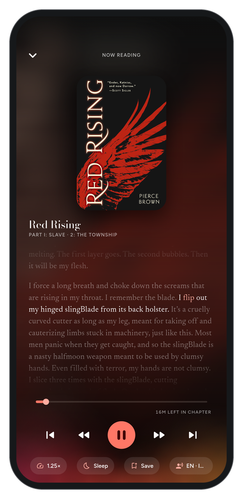
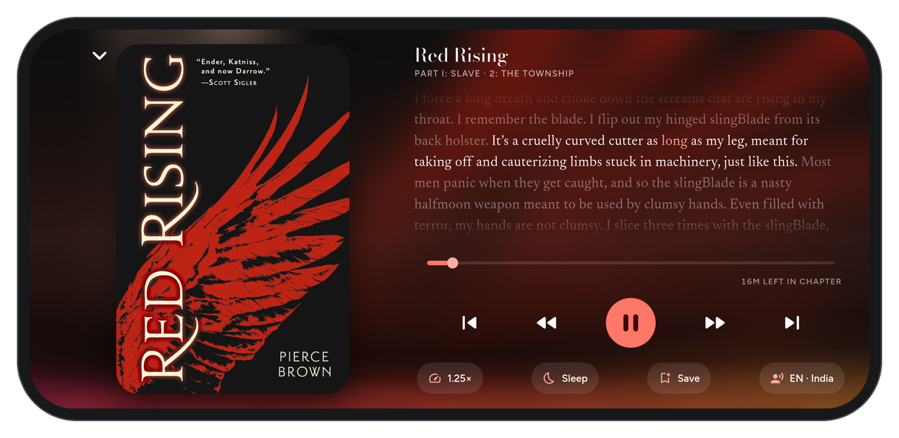

  

<h1 align="center">TomeVoice</h1>

  
  
  

Any book, read aloud: free, offline, on your phone. Open an EPUB, a PDF (a scanned
one too), a Word file or a web page, press play, and it reads to you sentence by
sentence, the spoken word highlighted, in your phone's voices or natural ones in 42
languages, with the screen off if you like.

  
  &nbsp;
  
  &nbsp;
  

  
  &nbsp;
  
  &nbsp;
  

  
  &nbsp;
  

No account. No cloud. Your books never leave the phone.

**Android only for now: download the APK from [Releases](https://github.com/Sayandeep1013/TomeVoice/releases/latest).**

---

## What it does

- **Opens almost anything.** EPUB, PDF, DOCX, ODT, MOBI / AZW3, FB2, RTF, HTML, Markdown
  and TXT, in whatever encoding they were saved. Pictures and maps in ebooks are shown in
  the text; PDFs can be read as text or shown as their real pages (pinch to zoom, dark at
  night); chapters are found even when a file does not list them. Footnotes stay on the
  page in small type and are not read, unless you turn on **Read notes aloud**.
- **Scanned PDFs, read by OCR.** A PDF of page images is read on the phone (Tesseract),
  in the languages you choose (Bengali, Hindi and English are one tap away). The
  language data is downloaded only when you use it, and pages are read once and kept.
- **Reads anything you share.** Share a link from your browser and TomeVoice reads the
  article, without its menus, ads or comments; share words from any app, or paste a link
  or text. A link to a book file downloads and imports it.
- **Reads it aloud** with the voices already on your phone, picking one in the book's
  language — a Bengali book gets a Bengali voice. Find any voice or language by typing.
- **Natural voices, if you want them.** About 180 voices that sound like people, in 42
  languages (Piper), made on the phone with no internet once downloaded, the book's
  language listed first, each with its size, quality, licence and a sample to hear.
  Kokoro (Hindi among its languages) and Kitten are there for fast phones. They are off
  unless you choose one: a voice is a 20 to 110 MB download (Kokoro 334 MB) and works
  the phone harder, about three times the processor of a built-in voice, so TomeVoice
  says so before anything downloads, tests how fast your phone runs it, and removes
  them with one tap.
  (Bengali has no natural voice yet; a Bengali book uses the phone's.)
- **Dialogue in a second voice.** Pick one, and words inside quotation marks are read
  by it while the narrator reads the rest.
- **A voice for each character** (experimental). A book's page lists who speaks in it,
  found from its speech tags ("said Elizabeth"), and each one's lines can have a voice of
  their own, aloud and in Save as audio. English books; a line it can't place stays in
  the dialogue voice.
- **An EPUB's own narration.** A book that comes with a recorded narration (EPUB 3 Media
  Overlays) can play it instead of a voice, its words lit as they are said, at any speed
  without the pitch changing.
- **Follows along.** The sentence being read is marked and the word under the voice is
  highlighted, timed from the audio itself.
- **Keeps going with the screen off.** Pause and resume from the lock screen,
  notification or headset; it stops for calls and when headphones come out. The media
  player in the notification shade shows the book's cover in its colours, a bar through
  the chapter you can drag, a speed button, and skips by chapter.
- **Made for reading, too.** Turn the book into pages, or keep one long scroll. Pages
  curl over like paper under your finger (or slide, or turn at once), by a tap at either
  side, a swipe or the volume keys. On its side the book lies open: two pages with a
  crease between them, the right one turning over the spine. A PDF's real pages turn the
  same way. Above each page is the chapter's name, and below it the minutes left in the
  chapter and the page count. Four papers: the app's colours, Ink, Papyrus and a dim
  Dusk for the dark. Where you read is where you are: scrolling or turning on without the
  voice moves your place, and Play starts there. After a jump from Contents or a search,
  one tap takes you back. Bookmark a page with the ribbon at the top (it shows in the
  page's corner; hold it for every bookmark in the book). Paragraphs can be spaced or
  indented like a printed book, the phone's bars can be hidden, and **Aa** in the reader
  sets the page. A tap on the text puts the top bar and the player away to read alone,
  and another brings them back. Listening on pages, the page turns as the voice reads
  onto the next one, not before. A long book or chapter list has a thumb at the edge:
  drag it to go straight through, a bubble naming the chapter. **Light** dims the page
  below the phone's lowest brightness and warms it for the night; **auto-scroll** moves
  the page on by itself when you read without the voice; a PDF's real pages can crop
  their margins so the print fills the phone.
- **Keeps reading when you leave the book.** Back goes to your library while the voice
  reads on; pause it from the library's player or the notification, and open the book
  again to find it still reading (Settings → Listening, on by default). Swipe TomeVoice
  away from Recents and it reads on; with the app closed, the phone's media card and a
  headset's Play pick the book up where it stopped, and Android Auto lists your books
  (never a secret shelf's; a downloaded APK shows in Auto once its developer setting
  *Unknown sources* is on). Settings → Listening also asks Android to leave TomeVoice's
  battery alone, with a link to your phone maker's own advice.
- **Save as audio.** A chapter, or a whole book as an M4B audiobook with its chapters
  marked, made exactly as it is read aloud, to play anywhere; or as an MP3, chapters
  and all, for the players that take nothing else. It goes on with the screen off, and
  with TomeVoice swiped away from Recents.
- **Starts where you stopped**, with a sleep timer for listening in bed.
- **Now Playing.** Swipe the player up for the cover and the page around the voice: the
  sentence being read lit and its word in the book's colour, the paragraphs before and
  after fading away as it glides along. A soft glow rises behind the player as the
  voice speaks, as bright as it is loud. Every book takes its colours from its cover,
  here and on its pages. Turned on its side, the cover sits beside the page, and in the
  reader the text keeps the screen with the player floating beneath it.
- **Find and keep.** Find a chapter by its number or title (type 2000 in a 3,000-chapter
  web novel and it is the only one left), or find a passage, a line you remember, in the
  chapter or the whole book. Press and hold a line to save
  it as a quote, bookmark it, copy it, or share it as a picture in the book's colours
  (with Undo if you saved by mistake); they wait in **Saved**, and show in the text as
  highlights in four colours, with your notes, ready to export as Markdown. Press and
  hold a word to look it up or translate its sentence. Fix how a name is said, for one
  book or all, and share the list as a file (or take in someone else's); in web novels
  leave out site notices and credits, and, if you like, the authors' and translators'
  notes, rows of symbols and chapter titles said twice: the page still shows them, the
  voice passes over (Settings → Reading rules).
- **Listening stats and streaks.** Your week, the last twenty weeks as dots, and a streak
  for every day you reach your daily goal (five minutes, or whatever you set).
- **Books from catalogues.** Browse and download from Project Gutenberg, Standard Ebooks
  or your own Calibre library (OPDS), straight onto a shelf.
- **For everyone.** TalkBack reads the pages and turns them, and Arabic, Hebrew and
  Persian books run right to left.
- **Home-screen widgets.** The book you are reading, its cover in a ring that fills as you
  go, with play (and chapter skips on the wider ones), also cut like a postage stamp;
  and your streak. Every size, in the book's colours.
- **Your library in one file.** Back it up to Downloads or Drive, or let it back itself
  up daily or weekly into a folder you pick, and restore it on a new phone, adding to
  what is there or replacing it. Backups leave out the natural voices (a download away)
  and warn when they hold a secret shelf; automatic ones leave a secret shelf out unless
  you say otherwise. TomeVoice also tells you when a new version is
  out, and installs it for you (Android asks you to confirm).
- **Sync, if you want it, to your own server.** Your places, quotes and listening time
  go to a WebDAV folder you choose, or your place to a KOReader sync server; the books
  themselves never leave the phone. Off unless you set it up.
- **Something wrong?** About → **Report a problem** shows you exactly what would be sent
  (the app and Android version, your phone's model, recent errors, never your books'
  titles or text) and opens a filled-in GitHub issue for you to send. Nothing is sent
  on its own.
- **A shelf you can organise.** Cover tiles with format, length and progress on each;
  your own categories (Reading, Later, or any you make), swiped between; the books you are
  in the middle of waiting at the bottom with a play button. **Tags and series**: sort
  by author or series (a series found in the book itself, or in the words several of
  your books' titles share), filter by progress, format, language, tag or series, and
  find copies of a book you already have. **Secret shelves** open only
  with your fingerprint, face or phone PIN and lock again when you leave; while locked
  their books are nowhere in the app, its widgets or the lock-screen player (Settings →
  Secret shelf, or press and hold the word Library).
- **A page for every book:** its cover (the book's own, one you pick, or a plain title
  cover), description, chapters, and the voice it is read in, with a sample to hear first.
  Play carries on where you stopped; any chapter opens right there.
- **Web novels too.** Install sites from LNReader's source list (there from the start) or
  bring your own list, search every site you installed at once,
  add a novel to your library and listen to it like a book: chapters are fetched as you go,
  new ones are checked for, even with the app closed, and sites behind Cloudflare are
  read through the phone's own browser engine. Download single chapters or whole novels
  to listen offline; downloads queue, carry on without the novel's page and try again.
  Each site runs in its own sandbox, off your home network, its code checked before it
  runs, and a site's changed chapter list never deletes what you downloaded. Move a
  novel to another site with its place and downloads, mark chapters read or unread,
  export what you downloaded as an EPUB, sign in to a site (kept for that source only),
  and let new chapters download by themselves. Your
  NovelDokusha library can be imported from its backup
  ([ADR-019](docs/10-decisions-adr.md#adr-019)).
- **Never an empty shelf.** A new install starts with *Pride and Prejudice* (public
  domain, with its 1894 peacock cover) and two popular web novels, *Shadow Slave* and
  *Lord of the Mysteries*, ready to play. Remove them like any other book.
- **Colour themes:** Forest, Lavender, Ocean, Black for OLED screens and Paper, your own
  colours (kept readable), or your wallpaper's on Android 12 and later. Text meets the
  WCAG AA contrast standard in every one. A short guide shows the way on a new install.
- **Gives you the voice controls readers don't:** speed, pitch, the gap between words,
  and pauses at commas, sentences and paragraphs.

## What it deliberately does not do

DRM-protected books (Kindle, Adobe), and anything that needs an account with us or a
cloud: there is none. Sync, if you set it up, goes to a server of your own.

## Install (Android)

1. Download `TomeVoice-<version>.apk` from the latest
   [Release](https://github.com/Sayandeep1013/TomeVoice/releases/latest). On an older or
   Android Go phone that says *App not installed*, take `TomeVoice-<version>-32bit.apk`
   instead.
2. Open it on your phone and allow installs from your browser or file manager when asked.
   If Play Protect calls it an unknown app, tap **More details → Install anyway**:
   TomeVoice isn't in the Play Store, so Google hasn't scanned it. (Or
   `adb install -r TomeVoice-<version>.apk`.) Updates install over the old version and
   keep your library. From 1.0 TomeVoice offers each new version itself: tap **Install**,
   then confirm Android's prompt.
3. Open it. A few books are already on the shelf; tap **+** to add your own or paste a
   link, open a book from any file manager with TomeVoice, or share a page to it from
   your browser.

**Coming from 0.5 or earlier?** From 0.6 TomeVoice has its permanent app id, so Android
installs it as a new app beside the old one. In the old app, update to 0.5.1 and use
**Settings → Back up library**. Install the new version, tap **Restore** when it offers
(or Settings → Restore a backup), check your books, then uninstall the old one.

Every push to `main` also builds an APK in
[Actions](https://github.com/Sayandeep1013/TomeVoice/actions/workflows/build.yml).

## How it is built

The hard part of the idea is the voice, not the reader. No text-to-speech engine lets
you control the gap between words, so TomeVoice synthesises each sentence to PCM, runs
it through its own pipeline (word gaps, pauses, loudness) and streams it to a player
it owns. That is also what makes playback gapless and the highlighting accurate.

| Part | Where |
|---|---|
| Audio pipeline (pure Dart, tested without a phone) | [`packages/tomevoice_audio`](packages/tomevoice_audio) |
| Every document format to one readable model | [`packages/tomevoice_document`](packages/tomevoice_document) |
| The Flutter app | [`app/lib`](app/lib) |
| Android: TTS engine, streaming player, screen-off service, PDF | [`app/android_overlay`](app/android_overlay) |

There is deliberately no local Flutter or Gradle requirement
([ADR-016](docs/10-decisions-adr.md#adr-016)): the Dart packages test with the plain Dart
SDK, and APKs are built by GitHub Actions.

The full design is in [`docs/`](docs/README.md); picking the project up cold, start at
the [session handoff](docs/16-session-handoff.md). Every decision and the alternatives
it rejected: [decision log](docs/10-decisions-adr.md).

## Licence

**GPL-3.0.** It is what lets the offline natural voices (Piper, Kokoro, eSpeak-NG) and
OCR (Tesseract) be ordinary dependencies rather than licensing problems. See
[ADR-014](docs/10-decisions-adr.md#adr-014). Each natural voice keeps the licence of
the recordings it was trained on, shown beside it in the app; what changed in each
release is in the [changelog](CHANGELOG.md).
