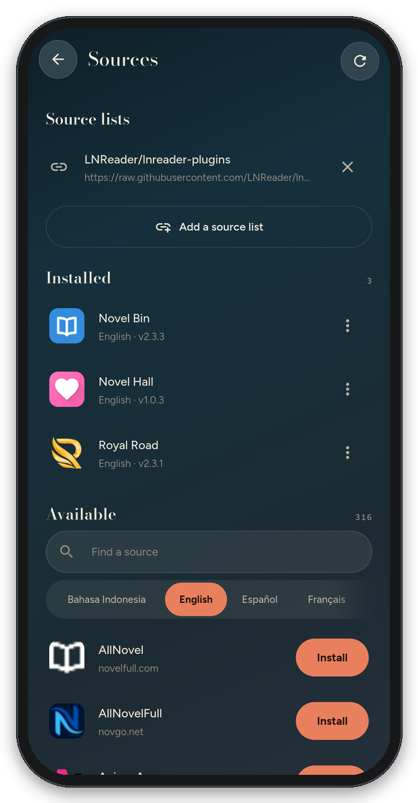

  

<h1 align="center">TomeVoice</h1>

  
  
  

Any book, read aloud. Open an EPUB, a PDF, a Word file or plain text, press play, and
it reads to you — sentence by sentence, the spoken word highlighted, on the device,
with the screen off if you like.

  
  &nbsp;
  
  &nbsp;
  

  
  &nbsp;
  

No account. No cloud. Your books never leave the phone.

**Status: Android app — download the APK from [Releases](https://github.com/Sayandeep1013/TomeVoice/releases/latest). Windows is planned.**

---

## What it does

- **Opens almost anything.** EPUB, PDF, DOCX, ODT, MOBI / AZW3, FB2, RTF, HTML, Markdown
  and TXT. Pictures and maps in ebooks are shown in the text; PDFs can be read as text
  or shown as their real pages; chapters are found even when a file does not list them.
- **Reads it aloud** with the voices already on your phone, picking one in the book's
  language — a Bengali book gets a Bengali voice.
- **Follows along.** The sentence being read is marked and the word under the voice is
  highlighted, timed from the audio itself.
- **Keeps going with the screen off.** Pause and resume from the lock screen,
  notification or headset; it stops for calls and when headphones come out. The media
  player in the notification shade shows the book's cover in its colours, a bar through
  the chapter you can drag, a speed button, and skips by chapter.
- **Starts where you stopped**, with a sleep timer for listening in bed.
- **Your library in one file.** Back it up to Downloads or Drive and restore it on a new
  phone, adding to what is there or replacing it. TomeVoice also tells you when a new
  version is out.
- **A shelf you can organise.** Cover tiles with format, length and progress on each;
  your own categories (Reading, Later, or any you make), swiped between; the books you are
  in the middle of waiting at the bottom with a play button.
- **A page for every book:** its cover (the book's own, one you pick, or a plain title
  cover), description, chapters, and the voice it is read in, with a sample to hear first.
  Play carries on where you stopped; any chapter opens right there.
- **Web novels too.** Install sites from LNReader's source list (there from the start) or
  bring your own list, search every site you installed at once,
  add a novel to your library and listen to it like a book: chapters are fetched as you go,
  new ones are checked for, and sites behind Cloudflare are read through the phone's own
  browser engine. Download single chapters or whole novels to listen offline. Your
  NovelDokusha library can be imported from its backup
  ([ADR-019](docs/10-decisions-adr.md#adr-019)).
- **Never an empty shelf.** A new install starts with *Pride and Prejudice* (public
  domain, with its 1894 peacock cover) and two popular web novels, *Shadow Slave* and
  *Lord of the Mysteries*, ready to play. Remove them like any other book.
- **Five colour themes:** Forest, Lavender, Ocean, Black for OLED screens, and Paper.
- **Gives you the voice controls readers don't:** speed, pitch, the gap between words,
  and pauses at commas, sentences and paragraphs.

## What it deliberately does not do

DRM-protected books (Kindle, Adobe), scanned PDFs with no text in them (no OCR), and
anything that needs an account or a server.

## Install (Android)

1. Download `TomeVoice-<version>.apk` from the latest
   [Release](https://github.com/Sayandeep1013/TomeVoice/releases/latest).
2. Open it on your phone and allow installs from your browser or file manager when asked
   (or `adb install -r TomeVoice-<version>.apk`). Updates install over the old version
   and keep your library.
3. Open it, tap **Add books**, pick one or more files. Or open a book from any file
   manager with TomeVoice.

Every push to `main` also builds an APK in
[Actions](https://github.com/Sayandeep1013/TomeVoice/actions/workflows/build.yml).

## How it is built

The hard part of the idea is the voice, not the reader. No text-to-speech engine lets
you control the gap between words, so TomeVoice synthesises each sentence to PCM, runs
it through its own pipeline (word gaps, pauses, loudness) and streams it to a player
it owns. That is also what makes playback gapless and the highlighting accurate.

| Part | Where |
|---|---|
| Audio pipeline (pure Dart, tested without a phone) | [`packages/tomevoice_audio`](packages/tomevoice_audio) |
| Every document format to one readable model | [`packages/tomevoice_document`](packages/tomevoice_document) |
| The Flutter app | [`app/lib`](app/lib) |
| Android: TTS engine, streaming player, screen-off service, PDF | [`app/android_overlay`](app/android_overlay) |

There is deliberately no local Flutter or Gradle requirement
([ADR-016](docs/10-decisions-adr.md#adr-016)): the Dart packages test with the plain Dart
SDK, and APKs are built by GitHub Actions.

The full design is in [`docs/`](docs/README.md); picking the project up cold, start at
the [session handoff](docs/16-session-handoff.md). Every decision and the alternatives
it rejected: [decision log](docs/10-decisions-adr.md).

## Licence

**GPL-3.0.** It is what lets the planned offline neural voices (Piper, eSpeak-NG) be
ordinary dependencies rather than licensing problems. See
[ADR-014](docs/10-decisions-adr.md#adr-014).
