

  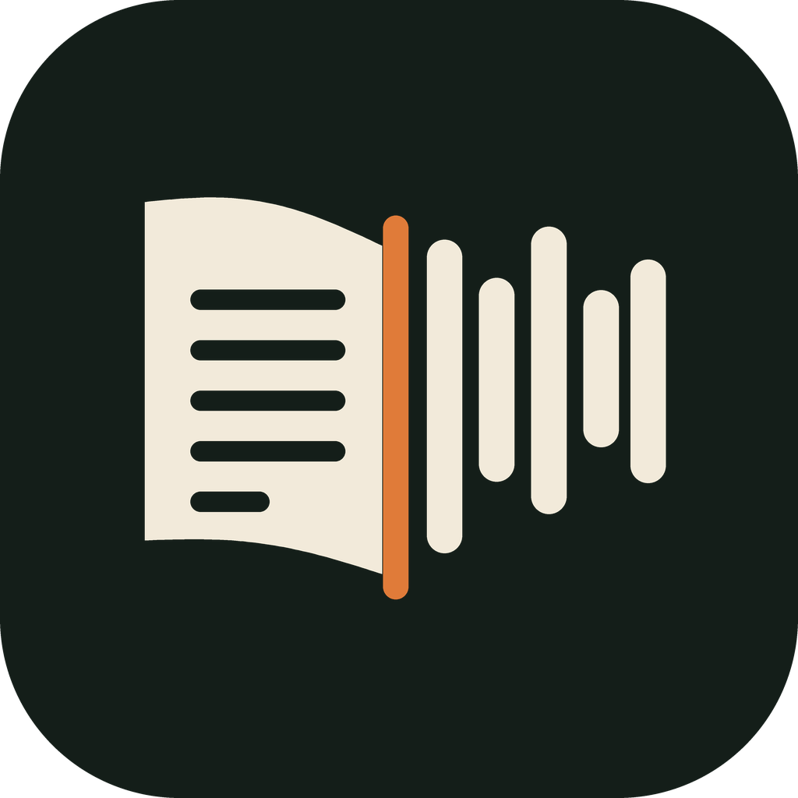

<h1 align="center">TomeVoice</h1>

  
  
  

Any book, read aloud: free, offline, on your phone. Open an EPUB, a PDF (a scanned
one too), a Word file or a web page, press play, and it reads to you sentence by
sentence, the spoken word highlighted, in your phone's voices or natural ones in 42
languages, with the screen off if you like. Keep a journal of what you think as you go.

<!-- 

  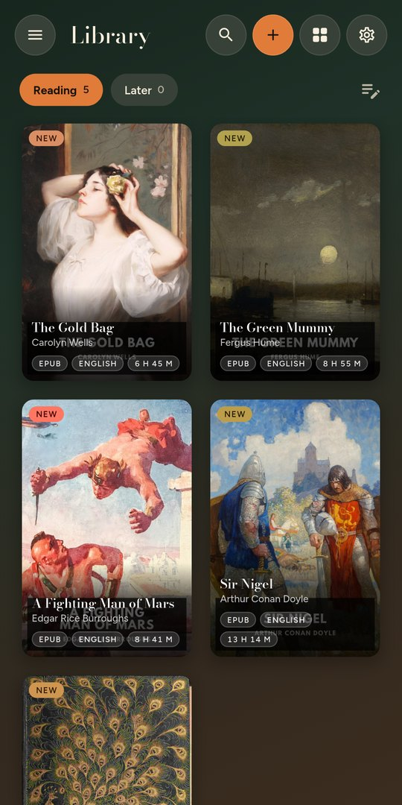
  &nbsp;
  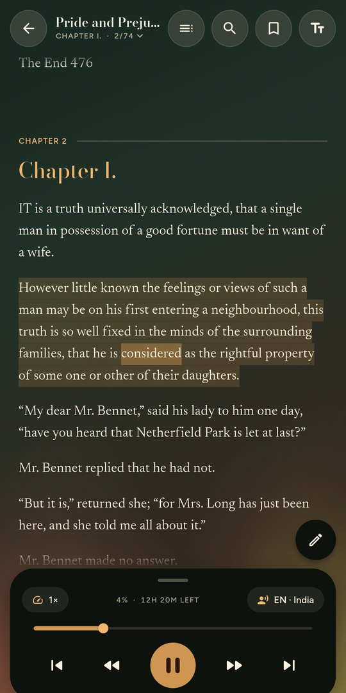
  &nbsp;
  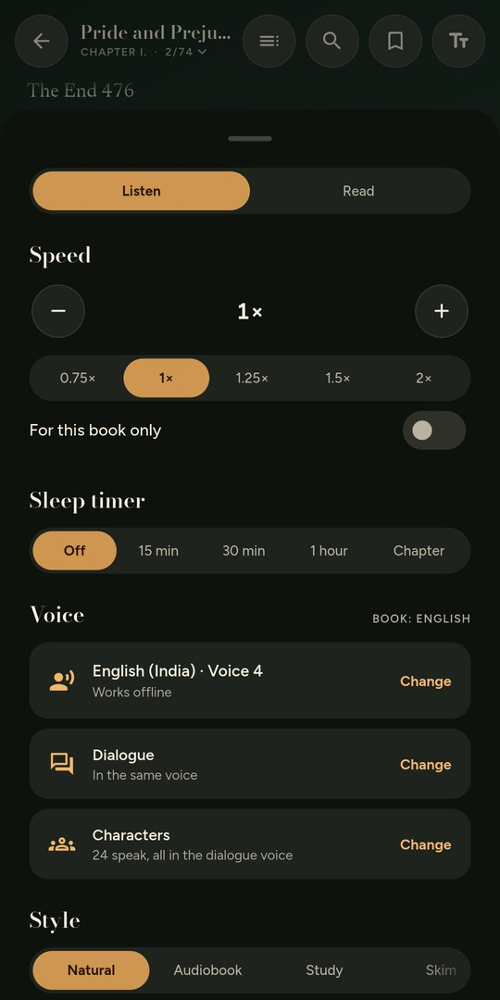
  &nbsp;
  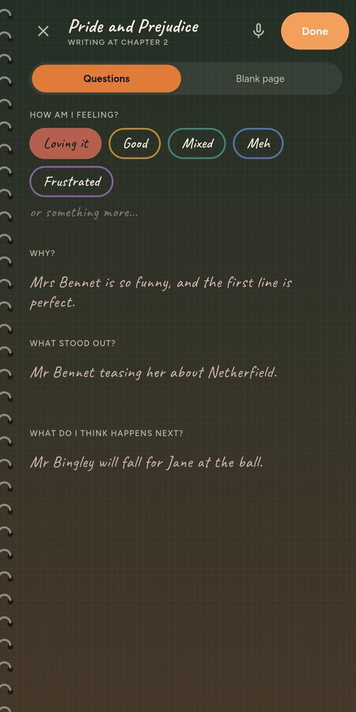

  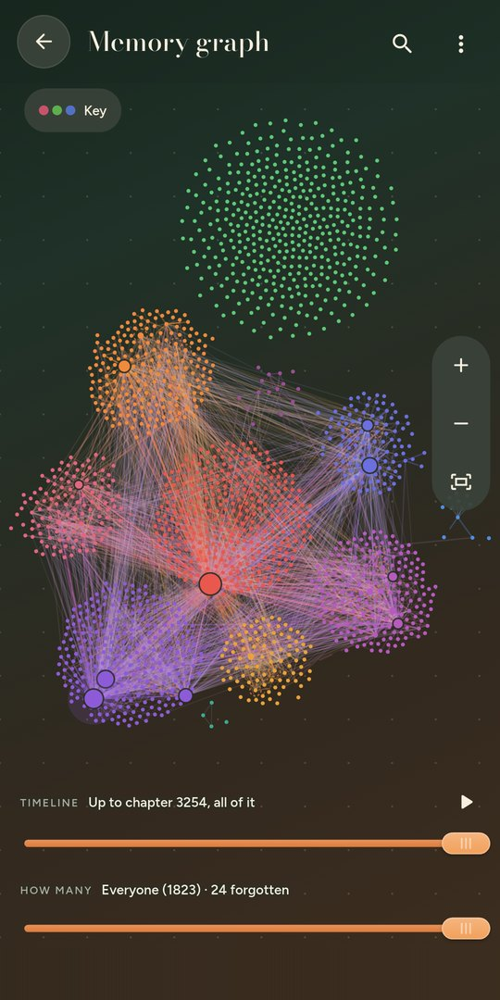
  &nbsp;
  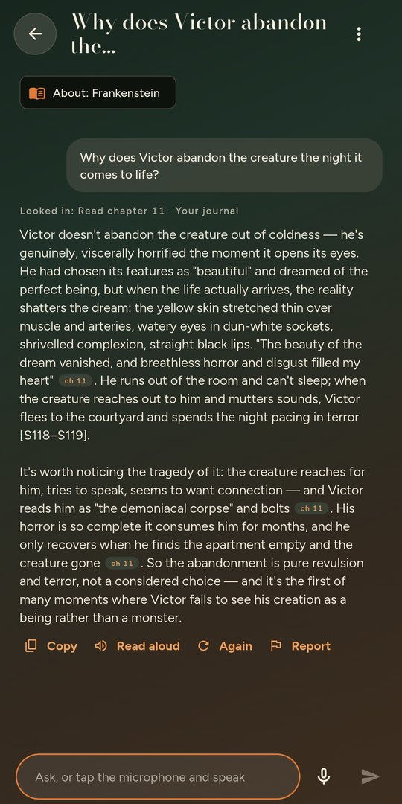
  &nbsp;
  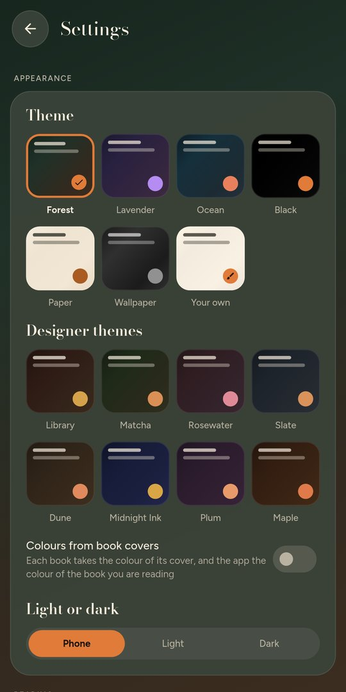
  &nbsp;
  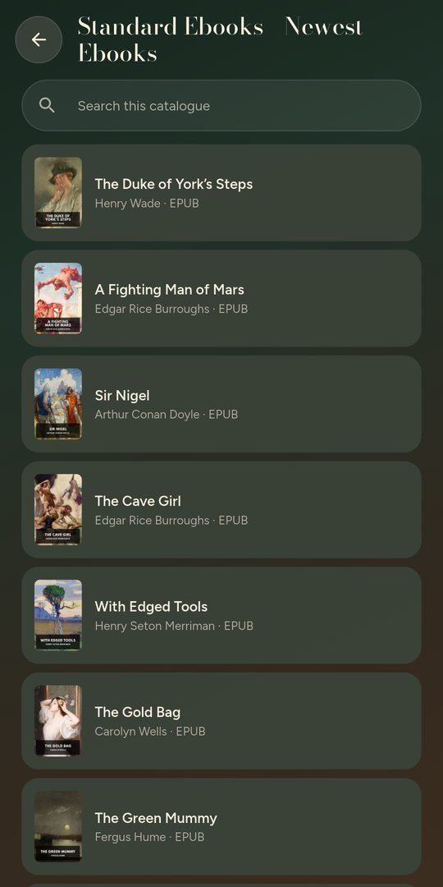

More screenshots
 -->

  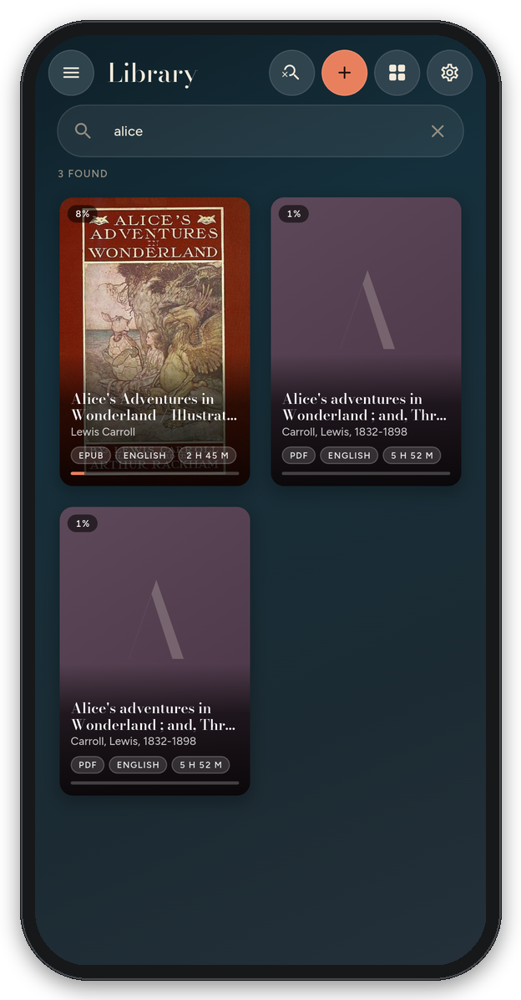
  &nbsp;
  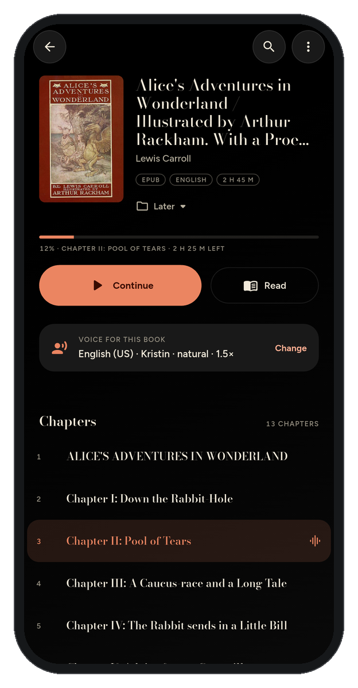
  &nbsp;
  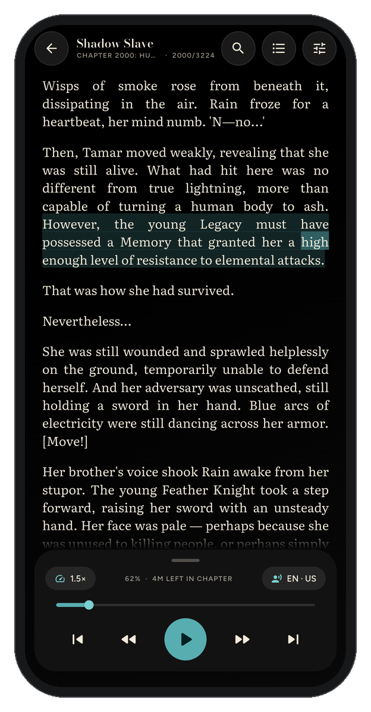

  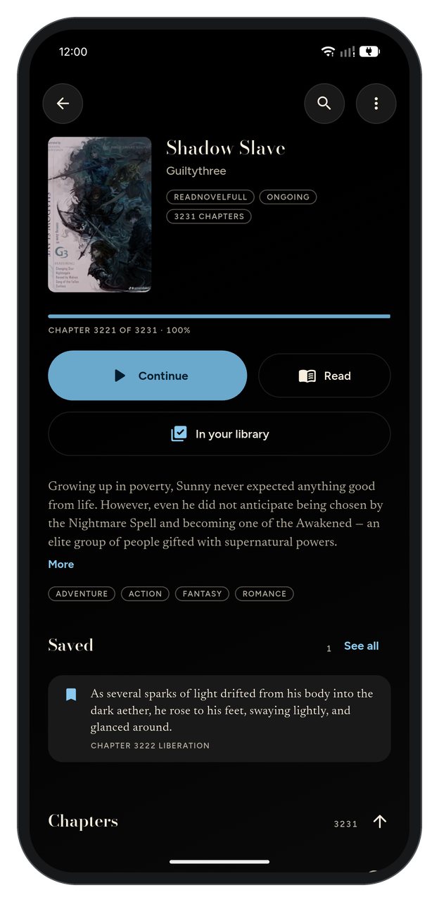
  &nbsp;
  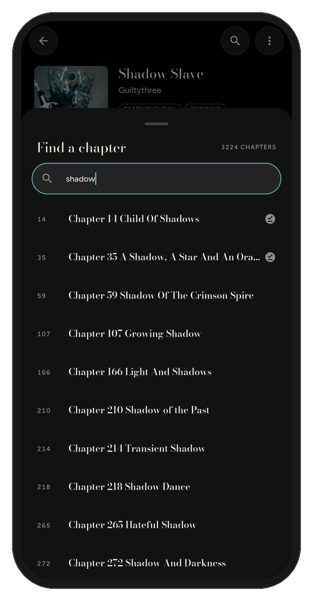
  &nbsp;
  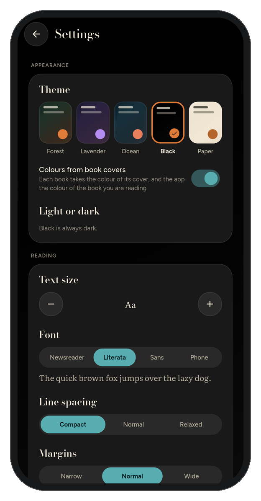

  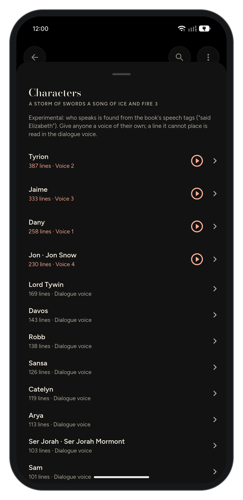
  &nbsp;
  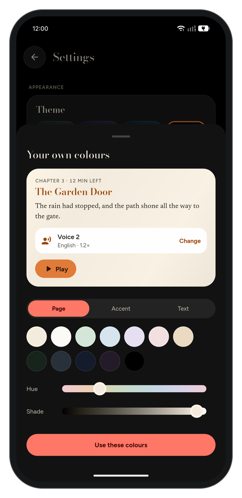
  &nbsp;
  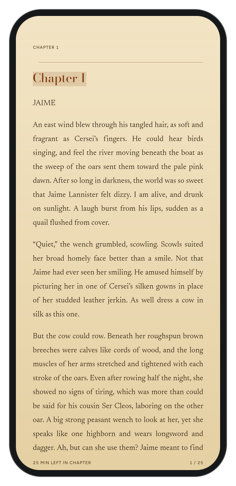

  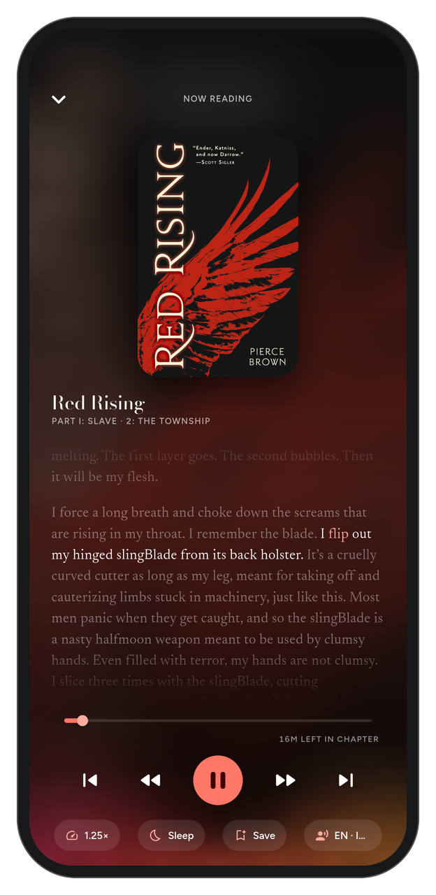
  &nbsp;
  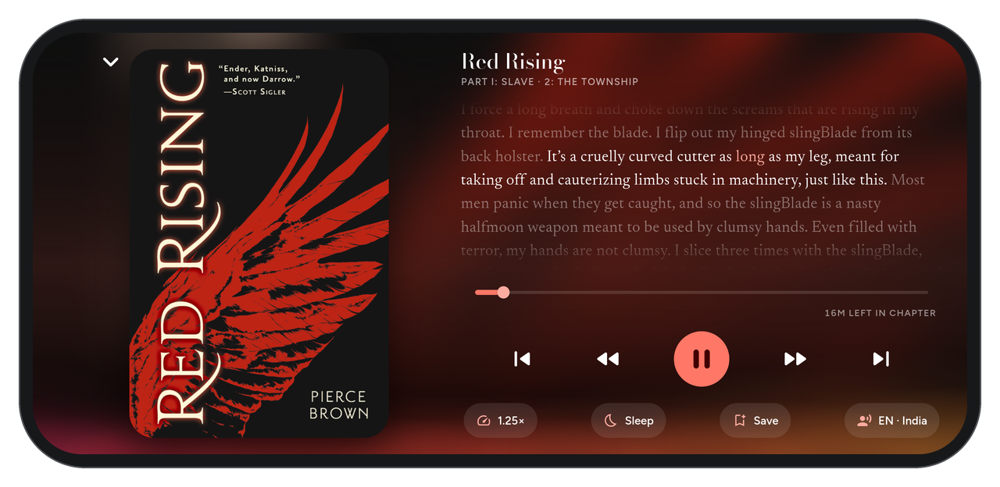

No account. No cloud. Your books never leave the phone (unless you give the AI
reading companion a key of your own: see below).

**Android only for now: download the APK from [Releases](https://github.com/Sayandeep1013/TomeVoice/releases/latest).**

With [Obtainium](https://obtainium.imranr.dev/), the button above adds TomeVoice set up to take the main APK (not the 32-bit one) and tells you when a new release is out.

## At a glance

| | |
|---|---|
| **Opens** | EPUB (with EPUB 3 recorded narration), PDF (scanned ones too), DjVu, MOBI / AZW / AZW3 / PRC (no DRM), FB2, DOCX, ODT, RTF, HTML, Markdown, TXT; web articles from a shared link; pasted text; web novels |
| **Reads aloud with** | the phone's own voices, or about 180 natural voices in 42 languages made on the phone with no internet (Piper, plus Kokoro and Kitten); dialogue in a second voice; a voice for each character (experimental) |
| **Fixes how it reads** | your own pronunciations ("say *Hermione* as…"), for one book or all, shared as a file; running headers, footers and page numbers left out by themselves (PDF, DjVu, scanned pages); two-column pages read down the left column, then the right; footnotes, and web-novel notices and credits, passed over |
| **PDFs and scans** | reflowed into paragraphs, or shown as the real pages (zoom, dark at night, margins cropped); scanned PDFs read by OCR on the phone (Tesseract), in the languages you pick |
| **Words** | press and hold a word to look it up in your dictionary app or translate its sentence in your translate app; *Who or what is…?* from the book's memory |
| **Library** | shelves; tags; series (found for you); sort by last read, date added, title, author, series or progress; filter by progress, format, language, tag or series; duplicates found; secret shelves; history |
| **Catalogues** | Project Gutenberg and Standard Ebooks built in; your Calibre library or any OPDS 1 or OPDS 2 catalogue, with search and sign-in |
| **Export** | quotes and highlights, with your notes, as Markdown; the journal as Markdown; a chapter or a whole book as an audiobook (M4B with chapters, M4A, or MP3 with chapters); a web novel as an EPUB |
| **Sync** | your own WebDAV folder, or a KOReader sync server |
| **AI, if you want it** | a memory of each book, chat about it, Explain this, name cards: with an API key of your own, nothing sent otherwise |

Not there yet: see [Not built yet](#not-built-yet).

---

## What it does

- **Opens almost anything.** EPUB, PDF, DjVu (by its hidden text), DOCX, ODT, MOBI / AZW3,
  FB2, RTF, HTML, Markdown and TXT, in whatever encoding they were saved. Pictures and maps
  in ebooks are shown in the text; PDFs can be read as text or shown as their real pages
  (pinch to zoom, dark at night); chapters are found even when a file does not list them.
  Read as text, a PDF's running headers, footers and page numbers are left out (the voice
  never says "Page 42", and a sentence running over the page is not cut by them), and a
  page set in two columns is read down the left one, then the right.
  Footnotes stay on the page in small type and are not read, unless you turn on
  **Read notes aloud**.
- **Your own chapters for a TXT book.** A web novel saved as one text file often heads
  its chapters in a way no reader knows ("#12 The Gate"). A TXT book's page has
  **Chapters**: lines that start with what you type (or match a regular expression), or
  a chapter every 1,000 to 5,000 words. It shows how many chapters that makes, and their
  first titles, before anything changes; your place, bookmarks and quotes stay with
  their words.
- **Replace the file.** Pick a corrected edition from a book's menu and it takes the
  book's place: your place, quotes, bookmarks, journal, voices, rules and shelf go with
  it, found again by their sentences.
- **Scanned PDFs, read by OCR.** A scanned PDF opens at once as its pages; to listen,
  its pages are read on the phone (Tesseract), several at a time, in the languages you
  choose (Bengali, Hindi and English are one tap away). The language data is downloaded
  only when you use it, and pages are read once and kept.
- **Reads anything you share.** Share a link from your browser and TomeVoice reads the
  article, without its menus, ads or comments; share words from any app, or paste a link
  or text. A link to a book file downloads and imports it.
- **Reads it aloud** with the voices already on your phone, picking one in the book's
  language — a Bengali book gets a Bengali voice. Find any voice or language by typing.
- **Natural voices, if you want them.** About 180 voices that sound like people, in 42
  languages (Piper), made on the phone with no internet once downloaded, the book's
  language listed first, each with its size, quality, licence and a sample to hear.
  Kokoro (Hindi among its languages) and Kitten are there for fast phones. They are off
  unless you choose one: a voice is a 25 to 125 MB download (Kokoro 334 MB) and works
  the phone harder, about three times the processor of a built-in voice, so TomeVoice
  says so before anything downloads, tests how fast your phone runs it, and removes
  them with one tap.
  (Bengali has no natural voice yet; a Bengali book uses the phone's.)
- **Dialogue in a second voice.** Pick one, and words inside quotation marks are read
  by it while the narrator reads the rest.
- **A voice for each character** (experimental). A book's page lists who speaks in it,
  found from its speech tags ("said Elizabeth"), and each one's lines can have a voice of
  their own, aloud and in Save as audio. English books; a line it can't place stays in
  the dialogue voice.
- **An EPUB's own narration.** A book that comes with a recorded narration (EPUB 3 Media
  Overlays) can play it instead of a voice, its words lit as they are said, at any speed
  without the pitch changing.
- **Follows along.** The sentence being read is marked and the word under the voice is
  highlighted, timed from the audio itself.
- **Keeps going with the screen off.** Pause and resume from the lock screen,
  notification or headset; it stops for calls and when headphones come out. The media
  player in the notification shade shows the book's cover in its colours, a bar through
  the chapter you can drag, a speed button, and skips by chapter. With the screen off
  nothing is redrawn, and on Android 12 and later the voice plays through the phone's
  power-saving audio output.
- **Made for reading, too.** Turn the book into pages, or keep one long scroll. Pages
  curl over like paper under your finger (or slide, or turn at once), by a tap at either
  side, a swipe or the volume keys. On its side the book lies open: two pages with a
  crease between them, the right one turning over the spine. A PDF's real pages turn the
  same way. Above each page is the chapter's name, and below it the minutes left in the
  chapter and the page count. Five papers: the app's colours, Ink, Papyrus, a squared
  Notebook (two pages with a spiral binding on its side) and a dim Dusk for the dark.
  The type is Newsreader, Literata, a sans, your phone's font or a .ttf or .otf of your
  own (kept with your library, so a backup carries it), with its weight and letter
  spacing. The top bar has a Contents button (and, with room, Scroll or Pages); a book
  in parts has a coloured tab for each down the side of its Contents. Bookmark a page
  with the ribbon at the top (it shows in the page's corner; hold it for every bookmark
  in the book). Paragraphs can be spaced or indented like a printed book, the phone's
  bars can be hidden, and **Aa** in the reader sets the page. A tap on the text puts the
  top bar and the player away to read alone, and another brings them back. Listening on
  pages, the page turns as the voice reads onto the next one, not before. A long book or
  chapter list has a thumb at the edge: drag it to go straight through, a bubble naming
  the chapter. **Light** dims the page below the phone's lowest brightness and warms it
  for the night; **auto-scroll** moves the page on by itself when you read without the
  voice; a PDF's real pages can crop their margins so the print fills the phone.
- **Look around without losing the voice.** In a book you read only by eye, your place
  follows your reading: scrolling or turning on moves it, and Play starts there. Once
  you have listened to a book, a scroll, a page turned, or a chapter, bookmark or
  passage picked only looks around: the voice reads on (or stays paused) at its place,
  the player names the chapter it is reading, and **Back to reading** returns to it.
  Only **Read from here** moves the voice.
- **Keeps reading when you leave the book.** Back goes to your library while the voice
  reads on; pause it from the library's player or the notification, and open the book
  again to find it still reading (Settings → Listening, on by default). Swipe TomeVoice
  away from Recents and it reads on; with the app closed, the phone's media card and a
  headset's Play pick the book up where it stopped, and Android Auto lists your books
  (never a secret shelf's; a downloaded APK shows in Auto once its developer setting
  *Unknown sources* is on). Settings → Listening also asks Android to leave TomeVoice's
  battery alone, with a link to your phone maker's own advice.
- **Save as audio.** A chapter, or a whole book as an M4B audiobook with its chapters
  marked, made exactly as it is read aloud, to play anywhere; or as an MP3, chapters
  and all, for the players that take nothing else. It goes on with the screen off, and
  with TomeVoice swiped away from Recents.
- **Starts where you stopped**, with a sleep timer for listening in bed.
- **Now Playing.** Swipe the player up for the cover and the page around the voice: the
  sentence being read lit and its word in the book's colour, the paragraphs before and
  after fading away as it glides along. A soft glow rises behind the player as the
  voice speaks, as bright as it is loud. Every book takes its colours from its cover,
  here and on its pages. Turned on its side, the cover sits beside the page, and in the
  reader the text keeps the screen with the player floating beneath it.
- **Find and keep.** Find a chapter by its number or title (type 2000 in a 3,000-chapter
  web novel and it is the only one left), or find a passage, a line you remember, in the
  chapter or the whole book. Press and hold a line to save
  it as a quote, bookmark it, copy it, or share it as a picture in the book's colours
  (with Undo if you saved by mistake); they wait in **Saved**, and show in the text as
  highlights in four colours, with your notes, ready to export as Markdown. Press and
  hold a word to look it up or translate its sentence. Fix how a name is said, for one
  book or all, and share the list as a file (or take in someone else's); in web novels
  leave out site notices and credits, and, if you like, the authors' and translators'
  notes, rows of symbols and chapter titles said twice: the page still shows them, the
  voice passes over (Settings → Reading rules).
- **A reading journal.** The pen over the player (or Write in the journal, in a book's
  menu) opens a notebook page that asks how you feel, why, what stood out and what you
  think happens next; skip any, or write freely on a blank page. Each entry is stamped
  with where the story had reached, the chapter the voice is reading or your place.
  **Journal**, in the menu, lists your entries by book, or shows them as a notebook: a
  page for each book, its cover taped at the top, your words in handwriting on squared
  paper, and numbered tabs down the edge. **Speak instead of writing**: the microphone
  on the page uses the phone's own speech recogniser (nothing recorded), the book
  waits while you speak, and with an AI key, Tidy adds the punctuation. Change the questions or add your own in
  Settings → Journal, with an offer to write at each chapter's end if you want one (off
  unless you turn it on; the voice never stops for it). Export it as Markdown; it goes
  in your backups.
- **Listening stats and streaks.** Your week, the last twenty weeks as dots, and a streak
  for every day you reach your daily goal (five minutes, or whatever you set).
- **Books from catalogues.** Browse, search and download from Project Gutenberg (its new
  OPDS 2 catalogue: Recently Added, Most Popular, bookshelves and subjects), Standard
  Ebooks, your own Calibre library, or any OPDS 1 or OPDS 2 catalogue you add, straight
  onto a shelf.
- **For everyone.** TalkBack reads the pages and turns them, and Arabic, Hebrew and
  Persian books run right to left.
- **Home-screen widgets.** The book you are reading, its cover in a ring that fills as you
  go, with play (and chapter skips on the wider ones), also cut like a postage stamp;
  and your streak. Every size, in the book's colours.
- **Your library in one file.** Back it up to Downloads or Drive, or let it back itself
  up daily or weekly into a folder you pick, and restore it on a new phone, adding to
  what is there or replacing it. Backups leave out the natural voices (a download away)
  and warn when they hold a secret shelf; automatic ones leave a secret shelf out unless
  you say otherwise. TomeVoice also tells you when a new version is
  out, and installs it for you (Android asks you to confirm).
- **Sync, if you want it, to your own server.** Your places, quotes and listening time
  go to a WebDAV folder you choose, or your place to a KOReader sync server; the books
  themselves never leave the phone. Off unless you set it up.
- **Something wrong?** About → **Report a problem** shows you exactly what would be sent
  (the app and Android version, your phone's model, recent errors, never your books'
  titles or text) and opens a filled-in GitHub issue for you to send. Nothing is sent
  on its own. On Android 11 and later, crashes in native code and Android closing the
  app for not responding reach the log too.
- **A shelf you can organise.** Cover tiles with format, length and progress on each;
  your own categories (Reading, Later, or any you make), swiped between; the books you are
  in the middle of waiting at the bottom with a play button. **Tags and series**: sort
  by author or series (a series found in the book itself, or in the words several of
  your books' titles share), filter by progress, format, language, tag or series, and
  find copies of a book you already have. **Secret shelves** open only
  with your fingerprint, face or phone PIN and lock again when you leave; while locked
  their books are nowhere in the app, its widgets or the lock-screen player (Settings →
  Secret shelf, or press and hold the word Library). **History** lists everything you
  opened, by day, to pick up again with one tap.
- **A page for every book:** its cover (the book's own, one you pick, or a plain title
  cover), description, chapters, and the voice it is read in, with a sample to hear first.
  Play carries on where you stopped; any chapter opens right there.
- **Web novels too.** Install sites from LNReader's source list (there from the start) or
  bring your own list, search every site you installed at once,
  add a novel to your library and listen to it like a book: chapters are fetched as you go,
  new ones are checked for, even with the app closed, and sites behind Cloudflare are
  read through the phone's own browser engine. Download single chapters or whole novels
  to listen offline; downloads queue, carry on without the novel's page and try again.
  Each site runs in its own sandbox, off your home network, its code checked before it
  runs, and a site's changed chapter list never deletes what you downloaded. Move a
  novel to another site with its place and downloads, mark chapters read or unread,
  export what you downloaded as an EPUB, sign in to a site (kept for that source only),
  and let new chapters download by themselves. Your
  NovelDokusha library can be imported from its backup
  ([ADR-019](docs/10-decisions-adr.md#adr-019)).
- **Book sources (this GitHub build only).** A source can offer whole book files
  rather than chapters: open a book, pick EPUB or PDF, and it downloads with your
  sign-in to that site and joins your library like a file you opened. When the site
  wants you signed in, or says you have downloaded as much as it allows for now,
  TomeVoice says so. The Play Store build does not open them.
- **Never an empty shelf.** A new install starts with *Pride and Prejudice* (public
  domain, with its 1894 peacock cover) and two popular web novels, *Shadow Slave* and
  *Lord of the Mysteries*, ready to play. Remove them like any other book.
- **Colour themes:** Forest, Lavender, Ocean, Black for OLED screens and Paper; eight
  designer themes (Library, Matcha, Rosewater, Slate, Dune, Midnight Ink, Plum and
  Maple); your own colours (kept readable), or your wallpaper's on Android 12 and later. Text meets the
  WCAG AA contrast standard in every one. A short guide shows the way on a new install.
- **Scene themes:** a place behind every screen, the page you read left plain:
  Enchanted forest, Silver witch, Space · solar, Dungeon, Sketch · chalk (drawn by
  hand: chalk on a grainy slate, the player's buttons painted in chalk), and Black rose,
  Silver dragon and Old tome, whose buttons, menus, sheets and slider are made of their own
  glass, slate or leather.
- **Gives you the voice controls readers don't:** speed (for every book, or this one
  only), pitch, the gap between words, and pauses at commas, sentences and paragraphs.

## An AI reading companion (2.0)

*New in 2.0. How it works, in full: [docs/14](docs/14-ai-companion.md).*

A companion that remembers the book with you: who everyone is, what happened and why,
and what is still unanswered. Off until you add a key; nothing changes for a reader who
never does.

- **Your own keys.** Google Gemini, Inception (Mercury), OpenRouter, Groq, OpenAI, or any
  service that speaks the OpenAI chat format (give its address). Add as many keys as you
  like, several from one provider too. A key that has used its quota rests until it
  comes back, and the next one takes over; a key the provider refuses is shown in red.
  Each key names a model for each job: one for building memories (many calls, so a
  cheap, fast one), one for talking (the best you have), and, on Gemini, OpenAI or a
  service of your own that has it, one for meaning search. **Check the key** lists its
  models and picks likely ones. Main menu → **AI** shows each key's state and what it
  used today.
- **What is sent, and what never is.** Straight from the phone to the provider you
  chose: there is no TomeVoice server, and no AI on the phone. Building a memory sends
  each chapter's text once; a question sends only what it needs (the passage, the
  book's notes and the parts of its text that bear on it, and your journal for that
  book). Books on a secret shelf are never sent, and any book can be kept away from the
  AI. Keys stay in the app's own storage and never go into a backup. By default the AI
  answers only from what TomeVoice gives it, so a well-known book is not spoiled from
  what the model learned elsewhere.
- **A memory of each book.** **Build memory**, on a book's page, reads the book once,
  chapter by chapter in the story's order, and keeps notes on the phone: a summary of
  each chapter; the cast, places, groups, items, powers and terms, with every name they
  go by and how they change over time (a rank, a title, who holds a sword, who is
  dead); the events, who took part and what led to what; mysteries from raised to
  resolved; and the story so far every 25 and every 250 chapters. Before it starts it
  tells you how many chapters, calls and tokens it will take. It goes on with TomeVoice
  closed for a long book (every hour or so, only on Wi-Fi and only while charging if you
  say so), and once begun it is kept up as you read. For a web novel it can download
  the chapters it needs, one at a time, and afterwards free the space they took: the
  memory keeps its own copy of their words.
- **A spoiler guard for each book**, off by default. On, the AI keeps to what you have
  read; for a book you read partly elsewhere, tell it **I've read up to chapter…**.
  A guide to all of it opens the first time you visit the AI page.
- **Talk about the book.** A button over the player opens Talk over the page, the book
  still reading. Ask who someone is, what happened, why; answers cite the chapters they
  come from, and a tap on one looks there without moving the voice. Answers can be said
  aloud in the voice reading the book, which pauses for them (**Talk answers aloud**, in
  Main menu → AI; off unless you turn it on). Every talk is kept in the book's journal,
  and the journal shows **All**, **My writing** or **Talks**.
- **AI chat.** Main menu → **AI chat**: chats of their own, about a book or a whole
  series, kept to come back to. Answers cite the chapters, follow on from what was
  asked before, and carry on if you leave the chat (its row says **Answering…**). An
  answer is read aloud only when you tap **Read aloud**.
- **Explain this.** Hold a sentence and the AI says what it means there in the story.
- **Who is "Oren"?** Hold a name for its card at once, from the book's memory with no
  waiting and no network: who or what it is, other names, how it stands now, relations,
  key events by chapter, a line they said. **Tell me more** asks Talk.
- **Who's who** lists everyone and everything the memory knows, by kind, searchable.
  The AI tidies the names as it goes (one card per character, a description renamed
  once the book names them), and you can too: hold a name to rename it, join it to
  another, or hand a card's later chapters to the character they really belong to.
- **The memory graph** shows the story's web on a dotted grid: the dozen who matter
  most drawn large, everyone else as fine points coloured by group or by kind, and who
  you may have forgotten ringed in orange. It pans and zooms smoothly with thousands. Centre it on anyone, two
  links out, or the whole web; a Story map of the book's groups as named islands; a
  timeline shows the web at any chapter and plays it growing; a tap lights someone's
  links and what they share with another.
- **Threads, chapter by chapter, find where.** The story's mysteries step by step,
  open or settled; what the AI noted of each chapter (one read again if it is poor);
  and every word of the whole book searched, even chapters not on the phone.
- **Theories.** Say what you think is going on: the AI weighs it, for and against, from
  what you have read. As the memory reads on it checks your theories, and tells you
  when you reach the chapter that settled one, never before.
- **Previously…** Back to a book after a few days away, a short recap of the chapters
  just before your place.
- **Series and sequels.** Building a book's memory asks whether it carries on from
  another book; the earlier books are built first, in order, and kept together as a
  series. **Book memories** (where **New memory** starts one) shows a series as one:
  **All books** reads them as one story, each book's chapters after the one before's
  and a character met in several books one entry, in Who's who, the graph, chapter by
  chapter and threads; or one book at a time. A chat can be about the whole series.
- **Talk elsewhere.** The memory as one Markdown page (the story so far, who matters,
  what is unanswered, your theories and journal) to copy or share into ChatGPT, Gemini
  or NotebookLM, kept to your chapter when the guard is on.

## Not built yet

What TomeVoice does not do yet, and is to be built:

- **Find-and-replace rules for the voice, with regular expressions.** Today a
  pronunciation matches a whole word as written.
- **"Don't read lines like this" for every book.** Today your own skip rules work in web
  novels; books get the built-in ones (notes, rows of symbols, titles said twice).
- **Your own margins and columns for PDF pages.** Today both are found automatically.
- **Brighter, sharper scans:** contrast for faint pages.
- **OCR for DjVu files that have no text layer.** Today a picture-only DjVu is refused.
- **Comics:** CBZ, CBR and CBT.
- **A dictionary and translation inside the app**, offline (StarDict). Today a word goes
  to your phone's dictionary or translate app.
- **Exporting bookmarks, and plain-text exports.** Today quotes and the journal export as
  Markdown.
- **WAV audio**, and old Word **.doc** files.
- **A steady 60 Hz mode.** On a 120 Hz phone, opening a book can still drop a few frames
  in its first moment, while the phone's graphics wake from rest; at 60 Hz each frame has
  twice the time ([C-39](docs/09-challenges-and-solutions.md#c-39)).

## What it deliberately does not do

DRM-protected books (Kindle, Adobe), and anything that needs an account with us or a
cloud: there is none. Sync, if you set it up, goes to a server of your own.

## Install (Android)

1. Download `TomeVoice-<version>.apk` from the latest
   [Release](https://github.com/Sayandeep1013/TomeVoice/releases/latest). On an older or
   Android Go phone that says *App not installed*, take `TomeVoice-<version>-32bit.apk`
   instead.
2. Open it on your phone and allow installs from your browser or file manager when asked.
   If Play Protect calls it an unknown app, tap **More details → Install anyway**:
   TomeVoice isn't in the Play Store, so Google hasn't scanned it. (Or
   `adb install -r TomeVoice-<version>.apk`.) Updates install over the old version and
   keep your library. From 1.0 TomeVoice offers each new version itself: tap **Install**,
   then confirm Android's prompt.
3. Open it. A few books are already on the shelf; tap **+** to add your own or paste a
   link, open a book from any file manager with TomeVoice, or share a page to it from
   your browser.

**Coming from 0.5 or earlier?** From 0.6 TomeVoice has its permanent app id, so Android
installs it as a new app beside the old one. In the old app, update to 0.5.1 and use
**Settings → Back up library**. Install the new version, tap **Restore** when it offers
(or Settings → Restore a backup), check your books, then uninstall the old one.

Every push to `main` also builds an APK in
[Actions](https://github.com/Sayandeep1013/TomeVoice/actions/workflows/build.yml).

## How it is built

The hard part of the idea is the voice, not the reader. No text-to-speech engine lets
you control the gap between words, so TomeVoice synthesises each sentence to PCM, runs
it through its own pipeline (word gaps, pauses, loudness) and streams it to a player
it owns. That is also what makes playback gapless and the highlighting accurate.

| Part | Where |
|---|---|
| Audio pipeline (pure Dart, tested without a phone) | [`packages/tomevoice_audio`](packages/tomevoice_audio) |
| Every document format to one readable model | [`packages/tomevoice_document`](packages/tomevoice_document) |
| The Flutter app | [`app/lib`](app/lib) |
| Android: TTS engine, streaming player, screen-off service, PDF | [`app/android_overlay`](app/android_overlay) |

There is deliberately no local Flutter or Gradle requirement
([ADR-016](docs/10-decisions-adr.md#adr-016)): the Dart packages test with the plain Dart
SDK, and APKs are built by GitHub Actions.

The full design is in [`docs/`](docs/README.md); what is tested where, and how the
APKs are built, is in [Testing & QA](docs/13-testing-and-qa.md). Every decision and the
alternatives it rejected: [decision log](docs/10-decisions-adr.md).

## Licence

**GPL-3.0.** It is what lets the offline natural voices (Piper, Kokoro, eSpeak-NG) and
OCR (Tesseract) be ordinary dependencies rather than licensing problems. See
[ADR-014](docs/10-decisions-adr.md#adr-014). Each natural voice keeps the licence of
the recordings it was trained on, shown beside it in the app; what changed in each
release is in the [changelog](CHANGELOG.md).
